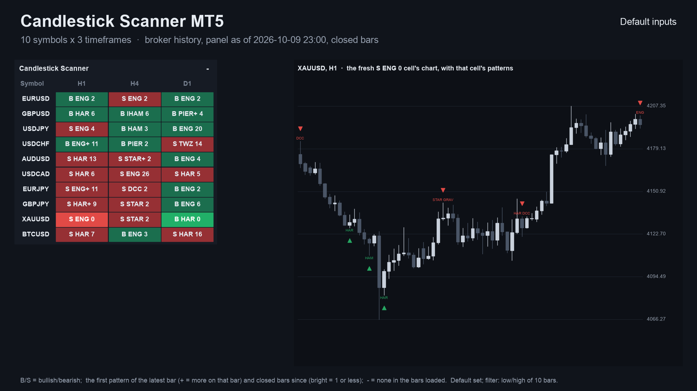
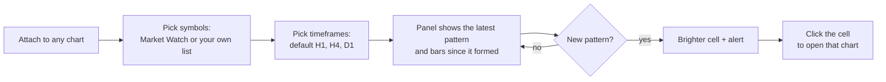
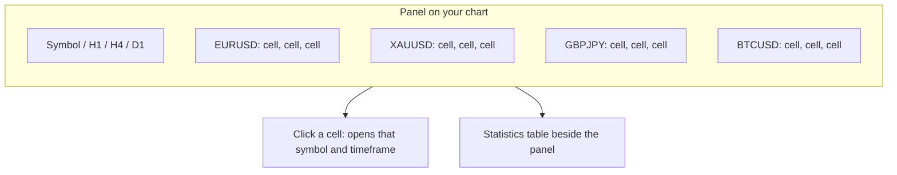
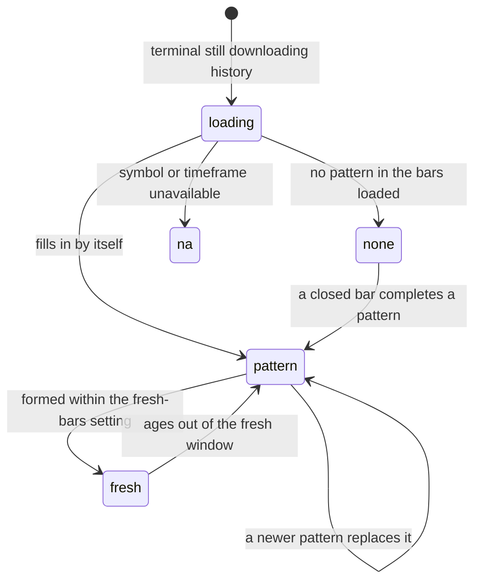
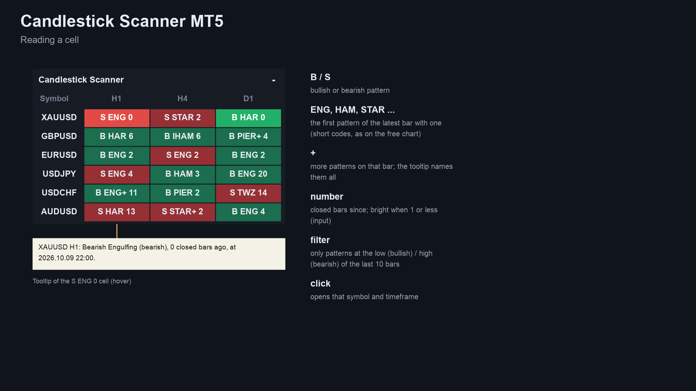
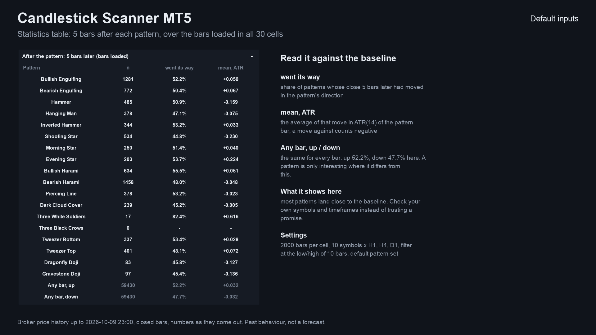
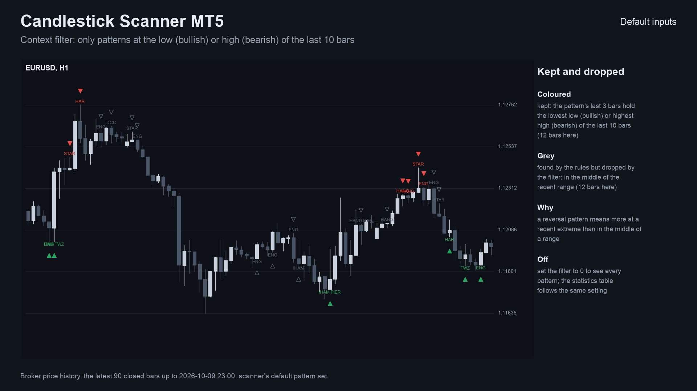
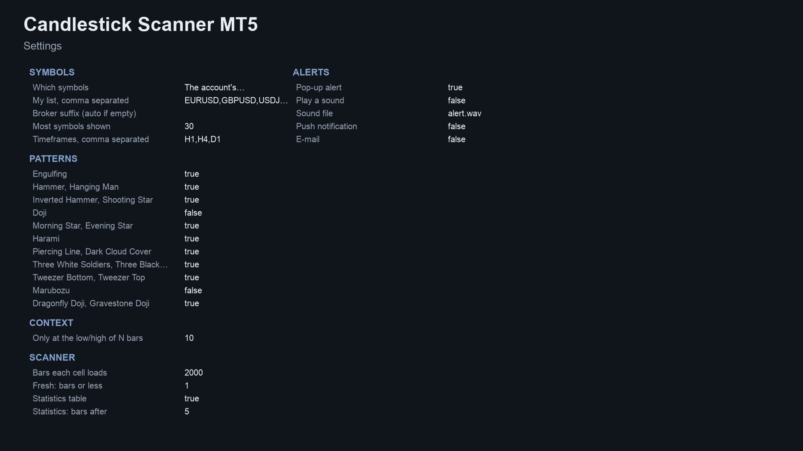
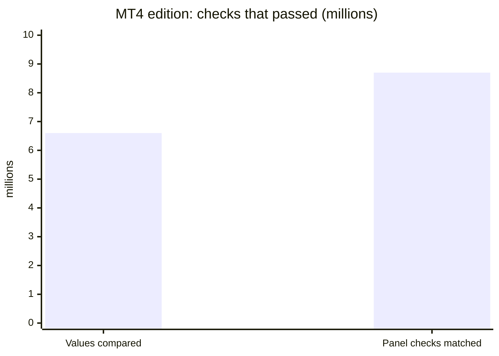

# Candlestick Scanner (MetaTrader 5 and MetaTrader 4)

A scanner indicator that watches **many symbols and timeframes for 21 candlestick patterns** in one panel on your chart,
can keep only patterns at a recent high or low, shows a statistics table next to a baseline, and sends an alert when a new
pattern appears.

> **This is a showcase repository: documentation and images only. There is no source code here.** The product is sold on
> the MQL5 Market. The free single-chart indicator it builds on has public source:
> [allanninal/candlestick-signal-alerts](https://github.com/allanninal/candlestick-signal-alerts).

**Website:** [allanninal.dev/mql5 (indicators)](https://www.allanninal.dev/mql5/#indicators) · [MT4 editions](https://www.allanninal.dev/mql5/#mt4) · [allanninal.dev](https://www.allanninal.dev)
· **Contact:** message me on [LinkedIn](https://www.linkedin.com/in/allanninal/).

## Get it on the MQL5 Market

| Product | Platform | Price | Link |
|---|---|---|---|
| **Candlestick Scanner** | MT5 | paid | <https://www.mql5.com/en/market/product/201779> |
| **Candlestick Scanner MT4** | MT4 | paid | <https://www.mql5.com/en/market/product/202406> |
| Candlestick Signal Alerts (single chart, source on GitHub) | MT5 | free | <https://www.mql5.com/en/market/product/201775> |
| Candlestick Signal Alerts MT4 (single chart, source on GitHub) | MT4 | free | <https://www.mql5.com/en/market/product/202358> |

The scanner is standalone: you do not need to install the free indicator to use it. Details, current price and the
Strategy Tester demo are on the Market pages.

## What it does

- A panel on the chart with **symbols as rows and timeframes as columns** (Market Watch symbols, or your own list).
- **In each cell:** the latest pattern on that symbol and timeframe, its direction (`B` bullish, `S` bearish) and how many
  closed bars ago it formed, for example `B ENG 2`. A `+` means more patterns completed on that bar; the tooltip lists them.
- **21 patterns:** the 13 of the free indicator plus 8 more. See the Market listing for the full list.
- A **brighter cell** when the latest pattern is recent (you choose how many bars count as fresh).
- An optional **context filter**: keep only patterns that sit at the lowest low (bullish) or highest high (bearish) of the
  last N bars, N adjustable, 0 = off.
- A **statistics table:** for each pattern, how many there were in the loaded bars, how often the close N bars later had
  moved in the pattern's direction, and the average move in ATR, **next to the same measures for any bar**, so you can see
  where a pattern differs from nothing special.
- **Click a cell** to open that symbol and timeframe.
- **Alerts:** pop-up (on by default), sound, push notification and e-mail, each switched separately. Nothing is sent while
  history loads, never twice for the same cell and bar, and not in the Strategy Tester. Alerts of the same second come as
  one message.
- **Closed bars only.** A cell does not change after its bar has closed. It places no orders.

### The grid at a glance

Each cell is one symbol on one timeframe. You read a whole watchlist in a single look instead of flipping through charts.

### What a cell can show

| | |
|---|---|
|  |  |
|  |  |

MT4 edition screenshots: [panel on a chart](images/mt4/01-scanner-on-chart.png), [how to read a cell](images/mt4/02-reading-a-cell.png),
[statistics](images/mt4/03-statistics.png). Some screenshots are illustrations built from broker history, not terminal
captures.

## Who it is for

Traders who read candlestick patterns on several symbols. If you watch one chart, the free
[Candlestick Signal Alerts](https://www.mql5.com/en/market/product/201775) marks 13 patterns there.

## Why it was built

- Candlestick patterns are the most-read chart method, and the free single-chart indicator covers one chart at a time.
- Our October 2026 market research (MQL5 Market, forums, freelance boards, book and course audiences) found multi-symbol
  scanners are a recurring want, but also that pattern indicators are a crowded category (roughly 170 on the Market, about
  54 free) with little to tell them apart. So the scanner adds two things that are easy to check: a whole-watchlist view,
  and a statistics table that shows each pattern **against the any-bar baseline** instead of asking you to trust it.
- Design rule carried over from the free indicator: trust. Cells use closed bars only, so what you saw does not change.

## What the statistics show

Descriptive only. For each pattern the table gives a count, how often price moved the pattern's way N bars later, and the
mean move in ATR, beside the same numbers for every bar. On broker history most patterns land close to that baseline, so
a pattern is only interesting where it differs from it. The table lets you check your own symbols and timeframes. It is
past behaviour, not a forecast, and no edge is claimed.

## How it was checked (results)

Every cell value, pattern flag and statistics counter was compared with an independent Python calculation, with all 21
patterns on.

| Check | MT5 edition | MT4 edition |
|---|---|---|
| Test files compared | 32 (EURUSD, GBPJPY, XAUUSD, BTCUSD x M15, H1, H4, D1 x 2 settings) | 108 (the same four symbols x M15, H1, H4, D1, two settings) |
| Result | 0 mismatches over 36,181 pattern bars, statistics counters included | 6,556,230 values compared, 0 differences |
| Panel counts vs the test's own cells | - | 8,674,389 checks matched after start-up |
| Cells using the forming bar | none | none |

The free indicator that shares the pattern rules also has its own published results (parity against a reference on every
bar, and an every-tick repaint test with 0 changed marks); see its repository. These are code checks, not trading results.

## Honest limits

- A scanner shows the state of a technical rule. It does not predict the market, and past patterns are no indication of
  future results. No profit or accuracy claim is made.
- It is an indicator: it places no orders and manages no risk.
- Pattern names have several textbook definitions; the scanner uses one fixed set of thresholds, so counts will differ from
  other tools.
- It needs the terminal running to alert, and push needs your MetaQuotes ID set up in the terminal.
- The source is not published; this repository documents what the product does and the results of its checks.

## Free vs paid

| | Candlestick Signal Alerts (free) | Candlestick Scanner (paid) |
|---|---|---|
| Scope | one chart | many symbols x timeframes in one panel |
| Patterns | 13 | 21 |
| Output | arrows and labels on the chart | latest-pattern cells, context filter, statistics table |
| Alerts | pop-up, sound, push, e-mail | pop-up, sound, push, e-mail |
| MT5 | [201775](https://www.mql5.com/en/market/product/201775) | [201779](https://www.mql5.com/en/market/product/201779) |
| MT4 | [202358](https://www.mql5.com/en/market/product/202358) | [202406](https://www.mql5.com/en/market/product/202406) |
| Source | [public on GitHub](https://github.com/allanninal/candlestick-signal-alerts) | not published |

---

**Website:** [allanninal.dev/mql5](https://www.allanninal.dev/mql5/#indicators) · [MT4](https://www.allanninal.dev/mql5/#mt4) · [allanninal.dev](https://www.allanninal.dev)
· Questions: message me on [LinkedIn](https://www.linkedin.com/in/allanninal/). All rights reserved, see [LICENSE](LICENSE).
Copyright 2026 Allan Niñal (https://www.allanninal.dev/mql5). All rights reserved.

This repository contains documentation and images only; it contains no source code. The text and images may not be
copied, redistributed or used commercially without written permission. The Candlestick Scanner products themselves are
distributed only through the MQL5 Market under the Market's own terms.
